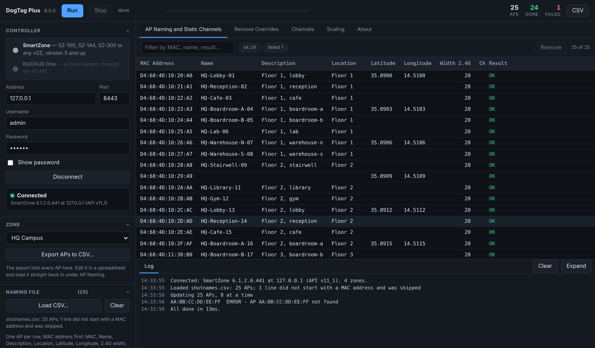

# DogTag Plus

Bulk naming, configuration and auditing of RUCKUS access points, through the
controller that manages them: a **SmartZone** (SZ-100, SZ-144, SZ-300 or any
vSZ, version 5 and up) or a **RUCKUS One** tenant. No installer, no runtime:
one binary that talks to the controller's own API.

> Author: Andrea Coppini · Feedback: <andrea@tacoppini.com>



## Download

Grab the file for your platform from the
[latest release](https://github.com/andreacoppini/dogtag/releases/latest):

| Platform | File |
|---|---|
| Windows | `dogtag-plus-windows-amd64.exe` (`-arm64` for Surface and Snapdragon) |
| Windows, zipped | `dogtag-plus-windows-amd64.zip`, the same binary for networks that block `.exe` downloads |
| macOS | `dogtag-plus-macos.zip`, one universal binary for Intel and Apple Silicon |
| Linux | `dogtag-plus-linux-amd64.tar.gz` (or `-arm64`) |

There is no installer. Unzip it and run it.

The binaries are unsigned, so both Windows and macOS warn on first launch. On
macOS the first run needs
`xattr -d com.apple.quarantine dogtag-plus-macos-universal`, or
right-click → Open. `SHA256SUMS.txt` in the release covers every file, and
every binary is built by [GitHub Actions](.github/workflows/release.yml) from
the tagged commit.

## Using it

Run it with **no arguments**, or double-click it, and it opens a console in
your browser, bound to localhost:

```
DogTag Plus 6.0.0
Console: http://127.0.0.1:52413
```

Pick **SmartZone** or **RUCKUS One** under Controller, fill in the connection
and press **Connect**. The tools are the tabs across the top.

### AP Naming and Static Channels

Load a CSV with one AP per row, MAC address first:

```
MAC,Name,Description,Location,GPSLatitude,GPSLongitude,24Width,24Channel,50Width,50Channel
D4:68:4D:10:20:A0,Lobby-AP,Front desk,Reception,35.8989,14.5146,,6,,36
D4:68:4D:10:21:A1,Cafe-AP,,,,,,,,
```

Check the table, press **Run**, confirm. Each row gets `OK` or the
controller's own error.

- Blank cells are left alone, so a file carrying only names changes only names.
- Rows whose first column is not a MAC address (a header, a note) are skipped.
- A channel given without a width means 20 MHz.
- Select rows and press **Delete** (or **Remove**) to drop them before a run.

### Remove Overrides

Load a CSV of MAC addresses (only the first column is read), tick which
per-AP settings to hand back to the zone or venue, and optionally switch the
2.4 or 5 GHz radio on or off or force the AP's address back to DHCP. The table
lists, per AP, what worked and what did not.

### Channels

Pick a zone or venue and press **Refresh** to count the connected APs on each
2.4, 5 and 6 GHz channel.

### Export

**Export APs to CSV** writes every AP in the selected zone or venue: MAC, name,
description, location, GPS, current channels, serial, status, model, IP. The
first ten columns are a naming file, so the export can be edited in a
spreadsheet and loaded straight back in.

Loading an export back **pins each AP to the channel it was on** when
exported, because the channel columns are filled in. Clear those columns first
if you only mean to rename.

### Scaling

The SmartZone capacity calculator: how many switches a cluster can carry
alongside a given number of APs, by version, platform and node count.

## RUCKUS One

Tick **RUCKUS One**, choose the region, and give the tenant ID plus an
application token's client ID and shared secret. Create the token in RUCKUS One
under **Administration → Account Management → Settings → Application Token**;
the tenant ID is on the same page. Changing APs needs a token with
administrator rights.

Everything works the same way from the same files, with these differences:

- Zones are **venues**.
- R1 has **no Location field**; that column is ignored.
- A name must be 2 to 32 characters; R1 refuses anything else.
- Changes are **accepted, then applied** by the cloud a moment later. `OK`
  means R1 accepted the change.
- Removing an override means switching that setting back to "use venue
  settings". The list is R1's own: radio settings per band, LED, smart monitor,
  BSS colouring, client admission control, directed multicast, management VLAN,
  sticky client steering, and a few model-specific ones that are off by default.
- R1 allows 2000 API calls a minute per tenant. If a large run hits that, the
  tool waits and carries on by itself.

## Command line

Everything the console does is available as flags, over the same engine:

```
dogtag-plus -ip 10.0.0.5 -user admin -ask-pass -zone "HQ Campus" -export aps.csv
dogtag-plus -ip 10.0.0.5 -user admin -ask-pass -names aps.csv -out results.csv
dogtag-plus -ip 10.0.0.5 -user admin -ask-pass -remove-overrides macs.csv -radio24 off
dogtag-plus -ip 10.0.0.5 -user admin -ask-pass -zone "HQ Campus" -channels
```

For RUCKUS One, replace the connection flags:

```
dogtag-plus -r1 -r1-region eu -r1-tenant <tenant-id> -r1-client-id <client-id> -r1-ask-secret \
  -venue "HQ Campus" -export aps.csv
```

Without an action flag (`-export`, `-names`, `-remove-overrides`, `-channels`)
the connection flags just pre-fill the console, which is what the original
DogTag did. Its flags all still work: `-ip=`, `-ipaddr=`, `-usr=`, `-pwd=`,
`-prt=`, `-debug=yes`.

Prefer `-ask-pass` (or `-pass-env`) to `-pwd`: an argument is visible in the
process list and lands in your shell history. A password given on the command
line is used by the console but never sent to the browser.

The exit status is non-zero if any AP could not be changed. Run
`dogtag-plus -h` for every flag.

### Update check

On launch it asks GitHub once whether a newer release exists, and says so: a
line after the run on the command line, a small badge beside the version in the
console. It never blocks anything, says nothing when it fails, and caches the
answer for a day. Turn it off with `-no-update-check` or
`DOGTAG_NO_UPDATE_CHECK=1`. It is the only connection the tool makes that is
not to your controller.

## What changed from DogTag 5

- **RUCKUS One** is supported alongside SmartZone.
- APs are worked **in parallel** (eight at a time; change it under Settings or
  with `-c`), instead of one after another.
- The SmartZone API version is **negotiated**: the tool asks the controller
  what it offers and uses the newest, instead of the fixed `v7_0` that newer
  SmartZone releases no longer accept. Pin one with `-api-version` if needed.
- Zones and AP lists of any size are read in full. The original asked for one
  page and silently lost anything past it.
- CSV files are parsed properly: quoted commas, quotes inside a name, the
  byte-order mark Excel writes, MACs with dashes.
- A row sends only what it sets. The original always sent the name, so a row
  with a blank name was an error.
- A **Stop** button, a confirmation before anything is changed, results that
  can be saved as CSV, and a session that is kept alive while you edit.
- The 6 GHz band is counted under Channels where the controller reports it.

## Changelog

One line per change, newest first. `!)` marks something that changes behaviour
you may be relying on; `*)` is everything else.

What's new in 6.0.0 (2026-11-23):

```
!) rebuilt in Go as a single binary with a browser console; the Xojo original is on the legacy branch;
!) smartzone - negotiate the API version with the controller instead of a fixed v7_0;
*) r1 - RUCKUS One support: naming, static channels, overrides, channel counts, export;
*) engine - work APs in parallel, with Stop and a confirmation before changes;
*) cli - every action available from the command line; the original flags still work;
```

## Repository layout

| Path | |
|---|---|
| `*.go` | the engine, the command line and the console server |
| `sz/` | the SmartZone API client |
| `r1/` | the RUCKUS One API client |
| `web/` | the browser console |
| `internal/fakesz/`, `cmd/fakesz/` | a stand-in SmartZone and RUCKUS One, used by the tests and for trying the tool without a controller |
| `docs/INTERNALS.md` | how it works, building it, and the API calls it makes |
| `docs/RELEASE-NOTES.md` | the text published with each release |
| `.github/workflows/release.yml` | builds and publishes every platform on a tag |

Building it yourself needs only Go:

```
go build -o dogtag-plus .
```

## The original DogTag

The Xojo application this replaces, with its last Windows and macOS builds, is
preserved on the [`legacy` branch](https://github.com/andreacoppini/dogtag/tree/legacy)
and is no longer developed. It remains the reference for what the tool is meant
to do.

## Known limits

- This version has been exercised against **simulated controllers**, not yet
  against live ones. The SmartZone calls are the ones the original made; the
  RUCKUS One calls follow the published API (Wi-Fi Services and View Model at
  docs.ruckus.cloud). Try it on one AP before a whole estate, and please report
  what a real controller says back.
- On RUCKUS One, `OK` means the change was accepted. The tool does not wait
  for the cloud to finish applying it.
- An export does not include channel widths: neither API reports them in the
  listing used.
- The binaries are unsigned on both Windows and macOS.

This is an unofficial, unsupported tool. Use it at your own risk.
